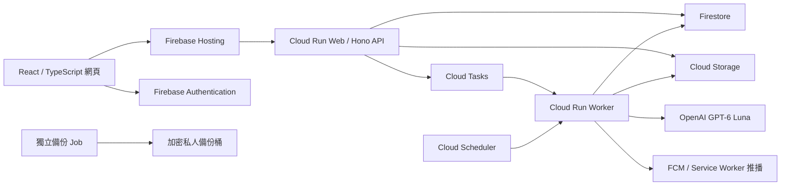

# 藥智通專案交接

交接日期：2026-10-24（Asia/Taipei）。本文件依本機程式、Git 紀錄、既有驗收收據及本次唯讀雲端盤點編寫。使用者目前要求停止功能開發、整合及發布，交接完成後等待新指示；不得由「交接」推定部署或清理授權。

**接手時最重要的事：GitHub 最新程式、線上程式、尚未提交的仿單工具是三個不同狀態。原工作區也不是乾淨的發布來源。**

| 範圍 | 交接時狀態 |
| --- | --- |
| GitHub／本機 `master` | `ea2f2804e60d4ee401d32fdf1b562302f2154e8e`，已推送；同 commit CI 全部通過 |
| 線上 Web／Worker | 仍為先前 `ad76753014f249ca6474cba48768ec50273949c7` 對應映像；本次核對 revision、digest 與流量未改變 |
| 新版容器 | `ea2f280` 已成功建置，**未部署、未切流量** |
| 新仿單工具 | 8 個檔案留在外部候選目錄，已離線測試，**未提交、未發布新來源** |
| 主工作區原修改 | 10 個已追蹤修改、12 個未追蹤檔案，共 22 個，逐檔 SHA-256 保持不變；本文件是另外新增的交接檔 |
| 產品方向 | 做好網站、面向一般民眾；目前沒有原生 App 開發計畫 |
| 固定 AI 配額 | 台北日期每日每人 20 次、全站 1,000 次；所有已驗證帳號可用，已取消 50 名限制；本次未改配額 |

## 路徑與閱讀方式

以下代號只為縮短證據路徑，不是環境變數：

- `W`：工作區 `C:\Users\Richi\OneDrive\桌面\藥智通`。
- `R`：實際 Git 專案 `C:\Users\Richi\OneDrive\桌面\藥智通\yaozhitong-personal`，本文件在此。
- `N`：私人進度／候選與測試證據 `C:\Users\Richi\AppData\Local\yaozhitong-tools\public-release-20261023-night`。
- 本機 Codex 的 `N` 實際解析位置：`C:\Users\Richi\AppData\Local\Packages\OpenAI.Codex_2p2nqsd0c76g0\LocalCache\Local\yaozhitong-tools\public-release-20261023-night`。換執行環境後若邏輯路徑找不到，先查此位置，不要建立同名空資料夾覆蓋判斷。
- `N/source` 是候選目錄，**不是 Git worktree，也不等同目前 HEAD**。不能將整個目錄直接覆蓋回主專案。
- `N/core-release-source-20261024`：已整合核心程式的乾淨測試快照。
- `N/tools-release-source-20261024`：以 `ea2f280` 為底，加上 8 個尚未整合工具的乾淨測試快照。

`N` 內有私人操作計畫、擁有者快照及測試資料；只應在本機授權環境讀取，不要整包上傳 GitHub。本文件不包含密碼、供應商金鑰、Auth 匯出或使用者照片。`W` 中其他歷史專案、展示影片及報告並非本次主要程式庫，未逐一審查，全部保留。

## 1. 實際完成的功能與架構

### 產品功能

| 功能 | 程式已具備的行為 | 使用與驗證界線 |
| --- | --- | --- |
| 帳號 | Email 註冊、信箱驗證、忘記密碼、Google 登入、登入狀態恢復 | 真人收信／重設／Google 登入有先前驗收；本次交接未重寄信或重新登入 |
| 藥袋辨識 | JPEG／PNG 上傳、影像檢查、AI 轉錄、逐項核對保存、資訊不足時補拍／補資料 | 單張 8 MB／3,200 萬畫素；HEIC 不支援。相機入口存在，最新實體相機裝置未驗證 |
| 藥品身分 | 比對官方目錄、要求劑型／含量／完整許可證等證據、阻止不明身分直接套仿單 | 不將目錄資料當成照片實際讀到的資料；息咳寧類資訊不足案例須走核對流程 |
| 仿單 | 官方來源、完整原文入口、字面引用、來源版本及欄位讀取狀態 | 發布量、可讀量、白話覆蓋與測驗覆蓋分開計算，尚未全目錄完成 |
| 白話說明／理解測驗 | 來源約束生成、條件檢查、答案保存、補齊入口、舊結果保留、無進展時停止續補 | 長仿單仍有 partial／unavailable；最新版安全修正尚未上線 |
| 用藥問答 | 問題送出、背景任務、歷史答案、引用與來源檢查、重開後讀回 | 歷史問答曾有來源條件問題；不安全舊答案會攔截。最新版正式雲端重開驗收尚待執行 |
| 提醒與紀錄 | 服藥排程、FCM 網頁推播、站內通知紀錄、服藥紀錄、需要時用藥重送防重複 | 先前 Android 鎖屏收件與點擊正常；最新部署後手機回歸仍待使用者配合 |
| 個人／家人管理 | 家庭藥箱、唯讀照護授權、設定、資料匯出及刪帳流程 | 不代表非空照護資料的災難復原已完成實測 |
| 公開使用與維護 | 已驗證帳號可用、交易式 AI 限額、私密問題回報、管理處理入口、備份與告警工具 | 規則已建立不等於告警有人收到；現無通知管道是使用者選擇 |

### 程式結構



- 前端：React 19、TypeScript、Vite；入口 `src/App.tsx`，主要流程在 `src/UIFlow.tsx`、`src/MedicationViews.tsx`、`src/ChatAnswer.tsx`、`src/NotificationViews.tsx`。請求與身分狀態在 `src/api.ts`、`src/auth.tsx`；推播在 `public/sw.js`、`src/web-push.ts`、`src/push-session.ts`。
- 後端：Hono，入口 `server/index.ts`、路由 `server/app.ts`、業務規則 `server/domain.ts`；`server/store.ts`／`server/blobs.ts` 提供本機與雲端儲存適配。
- AI：`server/llm.ts` 是供應商與逾時處理；`server/ai.ts` 編排辨識／說明／問答；`server/source-teaching.ts`、`server/safety-learning.ts`、`server/teaching-completion.ts`、`server/teaching-progress.ts` 處理來源條件、安全教學及補齊。
- 官方來源：`server/leaflets.ts`、`server/source-field-spans.ts`、`server/source-boundary.ts`、`server/chat-source-coverage.ts`；批次取得、準備、發布工具在 `tools/*tfda*`。
- 背景工作：`server/job-queue.ts`、`server/scheduler.ts`；請求與任務追蹤在 `server/request-telemetry.ts`、`server/job-telemetry.ts`。
- 共用 Zod schema／來源／藥品身分／學習模型在 `shared/`。部署在 `infra/deploy.ps1`、`infra/deploy-config.ps1`、`infra/deploy-hosting.ps1`；備份工具見第 5 節。
- Firestore／Storage 客戶端規則全部拒絕直接讀寫，應用資料經已驗證 Hono API 存取；Admin SDK 的擁有者／角色核對仍不可省略。內部 worker 另核對 OIDC audience 與呼叫身分。

## 2. 已驗證的成果與尚未驗證項目

### 精確版本的自動驗證

| 版本／範圍 | 結果 | 證據與限制 |
| --- | --- | --- |
| GitHub `ea2f280` | 1,982 單元、266 瀏覽器、173 Python；型別、81 組部署、17 組 Hosting、生命週期檢查全部通過 | [CI 39987323383](https://github.com/richie7p/yaozhitong-personal/actions/runs/39987323383)，本次核對 head SHA、所有步驟與完整 log；收據 `N/verification-ci-receipt.json` |
| 本機乾淨核心快照 | 108 檔／1,982 單元、型別通過 | `N/final-offline-verification/resumed-20261024/core-final-receipt.json`；不用主工作區混合修改冒充此測試來源 |
| 未提交工具快照 | 109 檔／1,994 單元、182 Python、型別通過 | `N/final-tools-verification-20261024/handoff-stopped-receipt.json`；未提交／未部署，此工具快照未另跑完整瀏覽器測試 |
| 最終頻率與條件檢查 | 7 檔／143 focused tests 通過 | `N/source-frequency-final-focused-20261024.json`，與完整測試有重疊，不可相加成獨立樣本 |
| 私人發布驗證器 | 14 離線案例：健康版接受、13 種錯誤狀態拒絕 | `N/independent-timeout/cloud-release-verifier-offline/after.json`；尚未對新版真正切流量後執行 |

CI log SHA-256：`b295aa2fb0c48f38863c1eb1f7dcdbf52f1ca4d4e66401bb148d7aaa9e2cf962`。瀏覽器測試包含桌面與 375px 視窗，屬自動流程測試，不等同 Android／iOS 真機或臨床驗證。

### 真實模型與來源驗證

- 最新四組完成的固定模型測試共 **18 個案例、72 次供應商 HTTP、982,869 回報 tokens**；包含重複、接續案例、歷史格式失敗及被拒輸出，不是 18 種獨立藥品，也不是全目錄成功率。彙整在 `N/public-teaching-status-draft-20261024.json`，該檔仍為待發布草稿，當時的 CI pending 欄位已由本次 CI 成功收據取代。
- 最後 `031505` 首次／補齊兩次真實模型測試，耗時約 141.9／120.3 秒，10 次 HTTP、125,855 tokens；0 格式錯誤／逾時。保存的教學 34 條與 8 題得以保留；用途另行生成。**仍未全仿單完成**：禁忌 1/1、警語 4/4、交互作用 8/10、副作用 0/2、過量 unavailable；補齊新增已解說範圍與題數均為 0，因此停止付費續補。
- 這組真實模型輸出取得後，頻率條件檢查又加嚴。最後程式已對相同 10 組供應商完整輸入／輸出做精確離線回放，兩次結果均完全相同、96 次字面引用核對、0 網路請求。見 `N/native-durable-recovery-031505-20261024-v2/binding-counterfactual-v3-exact-replay.json` 及獨立回放收據。這是錄製回放，不能寫成最後程式又做一次新生成。
- 上述 pair 只有 `coverage_gap` 類拒絕，不能當成最新真實模型已直接觸發 `reverification_failed` 硬拒絕分支的證據；該安全分支目前由單元／回放驗證。
- 20 份歷史結果在最終 guard 離線核對中分類保持一致；抽查 3 份可顯示問答、2 份不安全內容繼續攔截。見 `N/readonly-historical-guard-compat-local-binding-postfix-final.json`；最新正式雲端重開讀取尚未執行。
- 更早被中斷的第五組有 5 個呼叫 intent、0 個完整案例，供應商回應及用量不明；見 `N/native-final-recovery-031505-fixed/pause-reconciliation.json`。不可當成成功或零成本，不可盲目重送整組。

### 既有雲端／真人驗收

過去有完整辨識→核對保存→說明→測驗→問答流程、Email 驗證與重設密碼、真人 Google 登入、雲端讀取／斷線恢復、Android 鎖屏推播與點擊證據，分別記錄於 `docs/acceptance/`、[PUBLIC-READINESS](docs/PUBLIC-READINESS.md)、[DEPLOYMENT](docs/DEPLOYMENT.md)。這些文件橫跨不同版本，不得全部歸到 `ea2f280`。

先前生命週期驗收包含保存藥品／個人資料、撤銷舊 token、到期佇列恢復與刪帳清理。壓測有 emulator 多使用者與正式站共用一個帳號的多客戶端讀取；尚無大量獨立付費 AI 使用者的正式容量證據。

### 尚未驗證

1. `ea2f280` 真正部署後的完整正式站流程與新版 GET／歷史問答讀回工具。
2. 新仿單工具同 commit GitHub CI、單款 `028211` 發布及發布後讀回／教學／問答。
3. 全部來源的白話與測驗品質；掃描 OCR、複雜表格與未知版面的通用可靠性。
4. 最新 Android 鎖屏回歸、iPhone／iOS、HEIC；本輪依使用者意願不要求相機硬體驗收。
5. 最新備份是否涵蓋新增 117 原檔及相關 Firestore 文件、跨專案災難復原、實際告警事件轉換／通知送達。
6. 大量獨立使用者的雲端 AI 排隊容量／等待時間／長期成本、真人臨床正確性與使用者理解成效。沒有藥師核對機制。

## 3. 已知 Bug、技術債與安全風險

| 項目 | 已知事實／目前處置 | 狀態 |
| --- | --- | --- |
| 線上落後安全修正 | `9380c60`、`1dddbb7`、`ea2f280` 修正題幹條件、雙語限制、頻率作用範圍及硬拒絕傳遞；線上仍舊版 | **已修未部署**；不能宣稱正式站已取得所有修正 |
| 仿單覆蓋不足 | 雲端已發布 3,710；候選程式全量離線回放 3,157 可讀、553 held | 有來源不等於能產生完整白話；尚未全目錄逐款生成評估 |
| 長仿單未完成 | `031505` 交互作用／副作用仍 partial，`014277` 最後固定測試長警語 5/19 | 保留原文、明確 partial、無進展停續補；品質缺口仍存在 |
| 一次舊網路逾時 | 4 虛擬客戶端／180 讀取中的一次 15 秒 pre-header 逾時缺追蹤 | 歷史根因**未定位**；已加追蹤、GET 有界恢復，不能稱根治 |
| 規則可能過嚴 | 新保守檢查可能令舊問答／候選內容被擋 | 應依原文逐條重現排查；不得為通過案例移除保護 |
| 私人發布驗證器誤判 | 舊 helper 可能將「舊 ready revision＋新 template image」誤判新部署成功 | 私人 `N/cloud-release.py` 已修／14 離線案例通過，但修正未收進 repo，尚未新部署實證 |
| 文件版本混雜 | `IMPLEMENTATION-STATUS.md` 多為舊展示；`PUBLIC-READINESS.md` 仍記 3,661；其他文件有 3,710；壓測文件舊 maxScale=2 | 本文件與帶 commit 收據優先；不能將歷史數字拼成同版完整驗收 |
| 原工作區含研究修改 | 22 個 WIP 與其他 worktree 有重疊、舊工具或 staged 檔 | 是否全部需合併尚未審查；禁止整包覆蓋／提交 |
| 備份與權限故障 | 桶與金鑰同專案；還原需原 Auth／Firestore 刪除狀態；不同服務非同一時間交易 | 整專案刪除、主帳號失權、大規模 Auth 誤刪仍需專案外策略 |
| 告警無通知 | 四條規則既有啟用證據，使用者選擇不寄信、不設通知管道 | 需人工查看 Monitoring；最新觸發與送達未驗證 |
| 金鑰生命週期 | 過去對話曾貼供應商憑證；是否已輪替**未驗證** | 不重印／不提交。由擁有者安排輪替並同步 Secret，勿自行撤銷造成停站 |
| 私人資料保存 | `.env`、`.local`、node_modules 已 gitignored，但主資料夾位於 OneDrive | Git 忽略不代表停止同步；同步／存取政策未審查，不可擅自搬移或刪除 |
| 臨床與公開風險 | 無真人藥師覆核、無正式理解成效研究、無全產品第三方安全稽核 | AI／程式代理審查不等同臨床背書，不能承諾無 bug 或提供個人劑量決策 |

舊 `030418` 為原 PDF 無文字層後的完整人工轉錄，必須保留來源型態與核對紀錄。官方 HTML 的邏輯頁面及 canonical 文字 SHA 與 PDF 實體頁不同；見 [SOURCE-IMPORT](docs/SOURCE-IMPORT.md)。

## 4. 尚未完成工作（依優先級）

以下是待恢復開發後的順序，**本次只交接，不執行**；不給未經測量的完成時程。

| 優先級 | 工作 | 完成判準 |
| --- | --- | --- |
| P0 | 保全 WIP／證據並核對版本 | 第 6 節所有原檔雜湊、worktree index 與 HEAD 留存；先讀收據再接續 |
| P0 | 處理公開站與修正版本落差 | 使用者恢復並授權部署後才進行；精確 commit／digest、Web／Worker 真正 ready revision 及 100% 流量相符；配置與配額不變 |
| P0 | 新版正式站完整驗收 | 上傳實拍→核對保存→官方原文／白話→測驗保存→問答／歷史重開；不安全歷史仍擋、正常歷史保留；額滿可讀、不新增重複任務 |
| P1 | 正式 GET 恢復與問答讀回驗收 | `cloud-read-recovery-20261024.mjs`／`history-read-reopen.mjs` 對精確已驗證部署執行；before／after 資料及用量不變 |
| P1 | 來源工具整合與單款發布 | 審查 8 檔差異／pins；同版完整 CI；建立新的 `028211` 單款 manifest、validate／inspect，才評估 create-only 發布及讀回 |
| P1 | 白話、測驗與題幹補齊 | 先處理 `031505`、`014277` 剩餘區塊；引用／限制／頻率／因果與單位完整，不能只提高題數或解除 gate |
| P1 | 確認最新備份與告警 | 讀取下一次成功排程及 manifest，逐筆核對新增 117 原檔／文件；補異常事件驗證，通知設定依使用者指示 |
| P1 | 憑證與公開運維風險處理 | 擁有者確認金鑰輪替／存放；討論專案外備份與可被人看見的故障處理流程 |
| P2 | 更多來源 | 剩餘 15 個 flat-UL 候選、掃描圖、複雜表格、身分／多來源關係；每款均走官方證據，不追求假完整率 |
| P2 | 真機與容量 | 使用者方便時 Android 鎖屏回歸；獨立使用者雲端負載與 AI 等待／失敗恢復；iOS 如有需求另排 |
| P2 | 歷史分支／文件整理 | 逐項審查四個 worktree 與舊 PR；整理最新公開文件，保留歷史與研究修改 |
| P3 | 研討會／研究評估 | JCMIT 框架、公開實拍標準答案、對照與消融、費用／延遲／錯誤統計、人因評估；目前不是臨床效果研究成果 |

### 仿單最新批次的精確接點

- 交接前最後一次只讀基線：**3,710 個發布指標、3,713 份來源文件、3,720 個來源物件 metadata**。見 `N/coverage/flat-ul-20261024/cloud-baseline-first3.json`，這三種計數不可互換。
- 依前次全量快照尚有 **14,478 個有連結但未發布**、**3,057 個有效許可證無連結**；集合包含原料藥等不適合患者發布資料，不是都必須變成可用仿單。這兩個缺口數本次未重新全量盤點。
- 最新 flat-UL 試點只完成前 5 個，沒有展開其餘 15 個：

| 字號尾碼 | 技術證據 | 最終應用讀取器 | 發布狀態 |
| --- | --- | --- | --- |
| 059722 | 非矩形圖表，完整性證明 held | 未放行 | 未發布 |
| 044208 | technical eligible | `source_requires_review` | 未發布 |
| 028211 | technical eligible | 可讀，9 passages／9 字面引用／2 安全欄 | **唯一提出可續接發布的候選，仍未發布** |
| 062050 | 非矩形圖表，完整性證明 held | 未放行 | 未發布 |
| 006711 | technical eligible | `source_requires_review` | 未發布 |

- 證據：`N/coverage/flat-ul-20261024/handoff.project-stop-20261024.json`；所有 5 份原檔及現行目錄／來源索引綁定已核對。technical eligible=3，不可寫成新增可用仿單=3。
- 原三款 manifest `N/coverage/flat-ul-20261024/first5-prepared-final/batches/tfda-d1e7d13f98165055167853e2.json` 必須保留。**單款 subset manifest、dry-run plan、單款 validate／inspect 全部尚未建立／執行**，不可直接 apply 原三款 manifest。
- opt-in 模式 `numbered-outline-flat-ul-v1`，evidence `tfda-numbered-outline-evidence-v3-flat-ul`，serialization `tfda-numbered-outline-literal-v3-flat-ul`；預設自動模式及舊 v1／v2 行為保持不變。保持 DOM、位置、父條件與項目順序；不能推測新編號或醫療含義。

## 5. Firebase、Google Cloud、部署與環境現況

### 已核對的線上資源

| 項目 | 現況 |
| --- | --- |
| Project | `project-b6fe4904-e687-4365-b2f` |
| 區域 | `asia-east1` |
| 網站 | <https://project-b6fe4904-e687-4365-b2f.firebaseapp.com> |
| 資料桶 | `project-b6fe4904-e687-4365-b2f-yzt-test-data` |
| Cloud Tasks | `yzt-test-ai`，`asia-east1` |
| Runtime SA | `yzt-test-runtime@project-b6fe4904-e687-4365-b2f.iam.gserviceaccount.com` |
| Web | `yzt-test-web-00027-7l7`，100% 流量，timeout 120s、concurrency 40、maxScale 3 |
| Worker | `yzt-test-worker-00027-8c6`，100% 流量，timeout 600s、concurrency 2、maxScale 3 |
| 線上映像 digest | `sha256:e67cec365d4d689440483e71bf548e7372aa6c6407515a83a429573f37aebd64` |

本次唯讀設定證據：`N/handoff-cloud-readonly-20261024.json`。TEST 資源名稱沿用，但網站已提供已驗證帳號入口，不能因名稱有 test 就任意刪資料或測 destructive 操作。當前帳單餘額、budget、API 定價、最新備份排程與所有 IAM 未重新完整盤點，標記**未驗證**。

明確線上 env：`APP_MODE=firebase`、`SERVICE_ROLE=web/worker`、`AI_PROVIDER=openai`、文字／影像 `gpt-6-luna`、`PUBLIC_ACCESS_MODE=verified`、文字 reasoning `medium`。文字 timeout 90,000ms、一般 request 45,000ms、primary 22,000ms、text primary 12,000ms、job 240,000ms、text tokens 12,000、vision tokens 2,600。影像 reasoning `none` 是程式／部署設計，並非本次 env 清單中獨立讀出的設定值。

**不要只用程式缺省重建現場**：`server/config.ts` 缺省是 provider `nvidia`、mode `local`、public access `approved`、reasoning `none`；`.env.example`／正式部署顯式設定才是目前 OpenAI 組態。正式環境有拒絕 local 模式的防線。`.env` 存在且 Git 忽略，保留原檔，不要用範本覆蓋。

供應商私密值由後端 `.env`／Secret Manager 管理；Firebase Web 公開設定與伺服器供應商密鑰不可混用。不自動切換供應商，開發用 Gemini 與網站 Luna 無關。

### 已建置但未上線的新映像

- Commit：`ea2f2804e60d4ee401d32fdf1b562302f2154e8e`。
- Cloud Build：`e364be19-3a56-4819-9f66-d9a726fc8ab8`，成功。
- Tag：`asia-east1-docker.pkg.dev/project-b6fe4904-e687-4365-b2f/yaozhitong/app:ea2f2804e60d`。
- Digest：`sha256:49d64c2e8388cd7393092229e57796edb8ef20c4ad1f77f6696a907a5036fbb3`。
- 證據：`N/cloud-release-ea2f2804e60d/`。沒有 deployment intent／成功切流量收據；此次交接沒有部署或變更 IAM。未來以真實 build、revision digest 和 Ready 狀態核對，不能只看 tag 或 template。
- `N/release-holds.json` 中 `9380c607e75aa17b6e63f940e6290575bb0f3420`、`1dddbb7d261f3ca4a9a8ec046b2d06c28bf9920c` 中間版本不得作為此次新版部署目的。

### 備份、還原與告警

工具：`tools/ops-complete-backup.ts`、`tools/ops-complete-restore.ts`、`tools/ops-recovery-cleanup.ts`、`tools/deploy-recovery.ts`；範本 `infra/recovery-plan.example.json`、告警 `infra/monitoring-alerts.json`／`infra/recovery-alert.json`。預設 preview；本次不執行 execute 或清理。

已有每日台北 03:30 加密 Auth／Storage 備份 Job、Firestore 原生備份與七天保留設定的歷史驗證。AES-256-GCM、Secret Manager 固定金鑰版本、manifest pin、原物件 generation／SHA、照片一日到期限制須保留。最後實證快照 **3,605 檔／8 帳號**；實際寫入隔離目錄並核對後清理的是 **3,533 檔**，另外 72 檔有備份讀回證據。後增 **117 個官方原檔及其 Firestore 文件**仍待核對是否已進新快照。

Auth 演練包含 8 個帳號／6 組密碼雜湊、供應商 UID、停用狀態及一般合成帳號登入；不是新專案完整 OAuth／MFA／多租戶／非空照護資料復原證據。原正式資料不可覆寫；跨服務恢復須對照快照時間與最新刪除狀態，避免復活正常刪除帳號。詳細界線見 [BACKUP-RECOVERY](docs/BACKUP-RECOVERY.md)。

### 本機可用工具

- Node `v22.23.2`：`C:\Users\Richi\AppData\Local\hermes\node\node.exe`；專案要求 Node 22，README 寫 22.16 以上。
- Python `3.12.14`：`C:\Users\Richi\.cache\codex-runtimes\codex-primary-runtime\dependencies\python\python.exe`；CI Python 3.13。
- gcloud：`C:\Users\Richi\AppData\Local\yaozhitong-tools\gcloud-589.0.0\google-cloud-sdk\bin\gcloud.cmd`。
- gh：`C:\Program Files\GitHub CLI\gh.exe`。
- Firebase emulator 設定在 `firebase.json`：Auth 9099、Firestore 8085、Storage 9199、UI 4000；不要把歷史 `127.0.0.1:8085` 展示頁與新的 Firestore emulator 混同。當前實際本機 listen／進程未重新全面盤點。

## 6. 分支、未提交變更與尚未合併工作

### 主程式庫

- 遠端：[richie7p/yaozhitong-personal](https://github.com/richie7p/yaozhitong-personal)。目前分支 `master`；本機 HEAD、`origin/master` 與本次遠端查讀均為 `ea2f2804e60d4ee401d32fdf1b562302f2154e8e`。
- **主 worktree index 為空**；其他 worktree 有 staged 檔，不能一概稱全部 index 乾淨。
- `feature/personal-learning` 在 `52da6dd`，已核對為 master 祖先；分支留存不表示仍待合併。
- 舊開啟 PR [#1](https://github.com/richie7p/yaozhitong-personal/pull/1)：`fix/ai-project-audit-2026-10-04` → `master`，標題「修補藥智通依賴、跨平台驗證與真實 NVIDIA 測試」。本次僅列出，**相容性／是否過期未審查**；不可自動合併舊 NVIDIA 設定。

近期重要 commits：

| Commit | 技術意義 |
| --- | --- |
| `ea2f280` | optional teaching completion 必須傳遞安全重審拒絕 |
| `1dddbb7` | 保留雙語來源的限制條件 |
| `9380c60` | 有界補齊、題幹條件與頻率作用範圍檢查 |
| `ee99fab` | 已部署公開版的文件與已知缺口 |
| `ad76753` | 現在線上基準；教學完整性、使用者重試保護 |
| `b108b85`／`63ff843` | 備份／負載／公開驗收、用藥重試與 session race 保護 |

### 原有 22 個 WIP（逐檔雜湊未變）

已追蹤但未提交：

```text
README.md
package.json
server/ai.ts
server/catalog.ts
server/recognition-usage.ts
server/safety-learning.ts
tests/catalog-match.test.ts
tests/cross-page-source-fields.test.ts
tests/recognition-literal-recovery.test.ts
tests/safety-learning.test.ts
```

未追蹤：

```text
docs/JCMIT-EVALUATION-PROTOCOL.md
docs/JCMIT-EVALUATION-RESULTS-2026-10-21.md
docs/JCMIT-EVALUATION-TOOLS.md
docs/JCMIT-PAPER-PLAN.md
tests/evaluation-core.test.ts
tests/evaluation-report.test.ts
tests/jcmit-runner.test.ts
tests/recognition-packaging.test.ts
tests/safety-source-sections.test.ts
tools/evaluation-core.ts
tools/report-jcmit-evaluation.ts
tools/run-jcmit-evaluation.ts
```

保留不表示已通過完整整合審查。原 SHA 清單在 `N/final-progress.json` 的 `originalWip`，副本在 `N/final-working-files/`；本次盤點在 `N/handoff-inventory-20261024.json`。不要 `git reset --hard`、`git clean`、清除 `.local`、`git add .`、整包 stash／覆蓋或 force push。

### 其他既存 worktree（全數保留）

| 相對 `R` 的位置 | detached HEAD | 未提交項目 | 注意 |
| --- | --- | --- | --- |
| `.local/identity-review-20261021/worktree` | `f3418ec072e2e9ad4431b4dc80247926035d4f00` | 50 | CI、gitignore、photo E2E 修改及一批 TFDA 工具／文件；是否已等價整合未審查 |
| `.local/photo-input-ci-20261022/worktree` | 同上 | 2 | photo E2E 與 service-worker diagnostic |
| `.local/tfda-next-phase-association-20261022/worktree` | `d6576995c2e8a8e740035f2e1206c74152801586` | 12 | 包含 `AM`／`M `，**有已暫存內容**；必須分別保存 index 與 working tree |
| `.local/tfda-source-format-20261022/worktree` | `87fef85fc30ee10e25c6f8daed5f99b29a930355` | 6 | AI／安全學習／歷史問答／cache 測試修改 |

逐路徑狀態在 `N/handoff-worktrees-20261024.json`。本次沒有 prune、archive、移除或整理 worktree。

### 外部尚未提交成果

8 個新工具檔在 `N/tools-release-source-20261024` 及 `N/source`，以 `N/tools-release-pins-20261024.json` 與停止收據為準：

```text
tools/fetch-tfda-sources.py
tools/tfda-candidate-verification.ts
tools/prepare-tfda-sources.ts
tools/tfda-source-core.ts
tools/tfda-publication-core.ts
tools/tfda-flat-ul-evidence.ts
tests/test_tfda_flat_ul.py
tests/tfda-flat-ul.test.ts
```

既有 TS 差異包含換行／格式變更，另存 `N/coverage/flat-ul-20261024/tools.first5.semantic-review.diff` 供語意審查，不能只看 diff 行數。`N/integrate-core-20261024.py` 已執行完成且固定舊 base，**不要重跑**；`N/integrate-tools-20261024.py` 雖已備妥，尚未進行提交，交接期間不執行。

## 7. 重要技術決策與不可隨意改動的設計

1. **先核對藥品身分再配來源。** 藥名、劑型、含量、許可證的缺漏不能靠猜補；相似中文名可能是不同產品。缺資料提示補拍／補資料，避免錯配仿單。
2. **官方證據先於模型輸出。** 固定完整許可證、現行品名、原料藥分類、多分支來源、原檔 SHA 與全文守恆；AI 助手不能批准發布。已有八款保護來源與其他已存在版本不可批次覆寫。
3. **完整來源、可讀欄、白話覆蓋、題目覆蓋分開。** 引用原文不代表已完成白話解說；一題不代表全欄理解。保留 partial／held、完整原文入口及具體原因，禁止改標籤造完整率。
4. **安全條件不可因白話化而消失。** 父條件、年齡／族群、英文字句限制、例外、AND／OR、mg 與 mg/day、因果、跨頁／表格關係都必須保留。頻率要綁定當地前後文／清單作用範圍，不可回到整段「有出現同一詞就算支持」的判斷。
5. **安全拒絕優先於非退步統計。** 新 `reverification_failed` 必須傳遞；不能為保住舊題數、舊完成旗標或「沒有退步」而恢復不安全舊結果。舊內容／答案仍保留供追溯，顯示門檻另行核對。
6. **補齊有界且可停止。** 共用 job 期限，限制模型呼叫、上下文與累積容量；無實質進展不得反覆誘導付費續補。學習範圍與來源 hash／version／citation／range 綁定；來源更新不可沿用偽造／失效進度。
7. **保留健康 cache 與既有引用／答案。** Reader version 與 generation cache version 用途不同；不要任意全域失效。來源合併要有完整等價證明，不能破壞舊 chunk ID 或引用。
8. **配額與重送一致性。** 每人 20／全站 1,000、台北日期、交易式扣次、同識別碼恢復；不要清用量、改帳號、給管理員繞過或另開測試帳號掩蓋額滿。續補是新任務時正常扣次。
9. **讀取恢復與寫入恢復分開。** 安全 GET 首回應 15 秒邊界、至多一次恢復且總期限 45 秒；寫入透過相同 idempotency key／讀回既有結果，不可盲目重複新增。45 秒頁面請求與 240 秒 AI job 是不同期限，不能混為同一逾時。
10. **登入／切頁競態保護不可移除。** epoch／Abort／擁有者條件阻止晚到回應跨帳號、登出後恢復舊資料，或自動返回離開的頁面；「前端已登入」不取代後端授權。
11. **發布可追溯且不混入 WIP。** 乾淨 Git archive、精確 CI commit、build id／digest、實際 ready revision、流量及控制不變才算發布完成；template image 或 build 成功均不足。私人 helper 最新 SHA 在附錄。
12. **備份不復活已刪帳號／過期照片。** 固定 key version、manifest pin、generation、安全 metadata、最新刪除狀態與隔離目標；正式資料不可用演練工具覆寫。
13. **網站模型與開發助手分開。** 公開產品固定 Luna／文字 medium，不因接手 Codex 型號或 Gemini 外包改產品供應商。沒有授權不要擴縮容、換 Secret／IAM／queue 或調配額。
14. **驗收範圍明確。** 自動測試、錄製回放、模型互評、真人操作、臨床／研究成效分開記錄；不可用單一「全部通過」取代版本與範圍。

### 開發助手分工與實際完成範圍

- 原主工程師負責高風險來源／條件邊界、版本整合、發布與實測；使用者原先要求將適合的雜務交給 **Gemini 3.8 Flash high**，完成後可由 **Gemini 4 Argon high** 做第三方工程審查。
- Antigravity CLI `v1.4.6`，`C:\Users\Richi\AppData\Local\agy\bin\agy.exe`；安裝時 Google LLC 簽章與既有原生登入可用。登入是否未來過期本次未驗證。
- bridge `C:\Users\Richi\.codex\tools\antigravity-bridge\gemini-flash-high.ps1`／`delegate.py` 固定 `gemini-3.8-flash-high`，high，無 fallback；Argon 私人 runner 固定 `gemini-4-argon-high`。只傳公開、去識別來源，不傳環境金鑰或患者資料；不開全面跳過權限旗標。
- Flash 實際完成前 5 份公開來源結構 checklist，145.296s／27,306 tokens，逐項由程式／原 DOM 另行核對；不是臨床或發布核准。見 `N/gemini-work/flash-first5-review-20261024.json`。
- 大檔 CLI 曾顯示 SUCCESS 但回傳空內容／denied actions，必須算失敗；較小 `--print` 路徑已實證，大型 stdin 正式工作可靠性尚未證明。
- Argon focused review 回報 37,250 tokens；頻率反例已重現並修正，另一個 combiner 指控經實際相依核對無法到達，未列確認 bug。模型審查不能當成人類獨立或臨床審查。
- 目前相關代理／CLI 工作均已結束或停止，沒有安排自動接續開發。使用者恢復後才重新分工。

## 8. 下一位主任工程師建議優先任務

1. 先確認最新使用者指令是否已恢復開發；**目前只有交接授權**。閱讀本文件、第 6 節與 `N/project-handoff-checkpoint-20261024.json`，不要立刻跑部署或來源 apply。
2. 核對 `git status --short`、`git diff --cached --name-only`、HEAD、原 22 檔 SHA 與其他 worktree 的 staged 狀態。本文件預期是新未追蹤檔；其餘狀態應與交接一致。
3. 先閱讀最後收據而非沿用舊代理總結：`verification-ci-receipt.json`、`handoff.project-stop-20261024.json`、`handoff-stopped-receipt.json`、本次唯讀雲端盤點。過期 pending 狀態只由後來的精確證據取代，不覆寫歷史原件。
4. 恢復後先解決「線上仍舊版」與公開站回歸，再逐項處理單款來源、長仿單品質、備份／告警；不要同時混合 22 個研究 WIP、八檔工具和未知舊 PR。
5. 如要驗證正式讀取，使用 `N/cloud-read-recovery-20261024.mjs` 和 `N/history-read-reopen.mjs`；兩者只備妥，從未 execute。前者接受當日自然用量 0–20；不是滿 20 時要如實記錄「額滿讀取未現場驗證」，不清額度。舊 `cloud-read-recovery.mjs` 硬要求 20，保留但勿誤用。
6. 若要繼續單款來源，從 `028211` 新 subset／dry-run 開始；`044208`／`006711` 保持 reader held，另兩款保持結構 held。完成後才擴其餘候選。

### 不會呼叫付費 AI 的基本檢查

下列命令供恢復後參考；在主工作區執行會混入第 6 節 WIP，**不能當成乾淨 HEAD 的等價驗證**。應先選擇保留 WIP 的獨立乾淨測試目錄。不要為跑這些命令覆寫 `.env` 或清 `.local`。

```powershell
npm run typecheck
npm test
npm run test:e2e
npm run check:lifecycle
python -m unittest discover -s tests -p 'test_tfda_*.py'
powershell -File tools/check-deployment.ps1
powershell -File tools/check-hosting.ps1
```

`check:seminar:flow`、`check:learning:ai`、`check:local:ai` 等可能使用真 API／建立資料，不列為交接必要檢查。不要在此階段重新整機開關機；過往重開證據只屬當時指定資料版本。

## 附錄：關鍵證據與固定 pins

以下路徑相對 `N`；完整檔案比本文件摘要更適合機器核對。未列出的歷史成果仍保留。

| 檔案 | 用途／SHA-256 |
| --- | --- |
| `handoff-inventory-20261024.json` | 主 Git／原 WIP／版本盤點；最終交接檢查另存 checkpoint |
| `handoff-worktrees-20261024.json` | 其餘四個 worktree 完整 path／status |
| `handoff-cloud-readonly-20261024.json` | 兩個線上服務 revision／traffic／digest／白名單 env，無 Secret 值 |
| `verification-ci-receipt.json` | 精確 `ea2f280` CI 成功、計數與 log SHA |
| `core-release-pins-20261024.json` | 已整合核心八檔 pins |
| `tools-release-pins-20261024.json` | 未提交工具八檔 pins |
| `final-tools-verification-20261024/handoff-stopped-receipt.json` | `f4cbb590f2f2c552a64c165d5bf7b03dac743bf9af974605c8c2c626c92fa9a8`；當時 CI 尚待核對欄位由後續成功收據補足 |
| `coverage/flat-ul-20261024/handoff.project-stop-20261024.json` | `ae16a76f5d66b1da058bbcbf0d3de1c2b1b417224082e2fed4d7e9d8f6535aa2`；五款結果／cloud baseline／runtime pins／未做事項 |
| `coverage/flat-ul-20261024/cloud-baseline-first3.json` | `9d9caa69e08f62e9474cc21da0979245eeeafc52d5804b69e65b05135c82e025` |
| `coverage/flat-ul-20261024/first3-final-runtime-reader.json` | `525bc832ceaf6c5cd1cf013e435857fb5b9f4cdf71a85334ba94345aeff421e4` |
| `coverage/flat-ul-20261024/first5-prepared-final/batches/tfda-d1e7d13f98165055167853e2.json` | 原三款 manifest，`cf0db4c76ae2311bde869f352b3b941b5695dfc773dac13ef2f5699c7b0c2792`，不得當單款直接發布 |
| `cloud-release.py` | 修正後私人 helper，`842d412af30c836fb3942cb472780593bf2503a232906225e1ff1ffdd01ec810` |
| `cloud-read-recovery-20261024.mjs` | 未執行，`e8eecf99b22589de89761dcc4970f3c1445854b55dce565438313ec02d45cb80` |
| `history-read-reopen.mjs` | 未執行，`5c40f80bc69c3759cf05f68f814a4b472edcf7ae1250b2761d67697fc492de74` |
| `public-teaching-status-draft-20261024.md`／`.json` | 四組真實模型測試與品質限制，仍未更新成正式發布文件 |
| `native-durable-recovery-031505-20261024-v2/` | 最後真模型 pair、逐次持久化回應／usage、精確回放與獨立核對 |
| `independent-timeout/release-helper-review-20261024-v2.json` | helper 實際程式審查與離線錯誤狀態證據 |

核心最終檔案 pins：`server/source-teaching.ts` = `3516cf391afb5765bba05a0cc7316cdd51c8e8fc32d5a646d10948d4c91eecd0`；`server/teaching-completion.ts` = `a455c90353cf74a403dc4c448395b0bc833f4106513ac2fde5a7f5b9fd3952c3`。主工作區其他 WIP 檔與候選 runtime hash 不同屬已知現象，勿因此自動覆蓋。

原有主文件入口：[README](README.md)、[TFDA 資料紀錄](docs/TFDA-LEAFLET-INGESTION.md)、[公開使用狀態](docs/PUBLIC-READINESS.md)、[備份還原](docs/BACKUP-RECOVERY.md)、[負載測試](docs/LOAD-TESTING.md)、[個人貢獻](docs/CONTRIBUTIONS.md)、[部署](docs/DEPLOYMENT.md)。涉及日期或版本衝突時，以實際程式、精確收據及本次盤點為準，不以較舊首頁文字推斷功能已在現站生效。

### 本次交接檢查記錄

最終檢查結果與文件 SHA 另存 `N/project-handoff-checkpoint-20261024.json`：檢查 UTF-8、八個必填章節、引用本機證據存在與固定 SHA、敏感憑證格式、主 HEAD／index、原 22 檔 byte hash 與其他 worktree 原狀。未重跑付費 AI、未建立新帳號、未部署、未發布仿單、未清理資料、未提交或推送交接變更。交接後停在此狀態，等待新對話明確接手。
